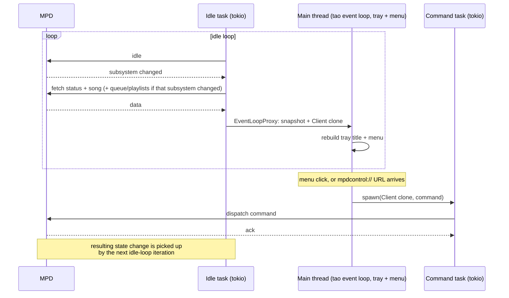

# How it works

A Cargo workspace of four crates:

| Crate | Responsibility |
|---|---|
| `crates/controller` | the menu-bar app and `mpdcontrol://` URL scheme — everything below |
| `crates/albumdb` | SQLite album database: schema, domain types, pure derivation logic |
| `crates/album-tool` | the `scan`/`sync`/`status` CLI that maintains it |
| `crates/mpd-conf` | parses MPD's own `mpd.conf`; shared by both binaries |

The two halves are otherwise independent — `controller` doesn't depend on
`albumdb`. For the album side see [album-database.md](album-database.md); the
rest of this document is about `controller`.

`mpd-conf` exists so neither binary duplicates settings MPD already owns: both
infer the port (and the album database's location) from `mpd.conf` rather than
asking to be told twice. It deliberately returns `music_directory` as an
`Option` and leaves "is that required?" to the caller — `album-tool` can't
work without it, the menu-bar app doesn't care.

One binary, one long-running process. Both entry points — the menu bar and the
URL scheme — are handled inside the same process, which owns the MPD
connection and any future in-memory state.

| Module (under `crates/controller/`) | Responsibility          |
|--------------------|--------------------------------------------------------|
| `src/main.rs`      | startup, `tao` event loop, tray icon + menu, URL handling |
| `src/mpd.rs`       | MPD connection, `idle` loop, reconnect/backoff, snapshots, queue/playlist caches |
| `src/command.rs`   | decoded command string → dispatch against MPD          |
| `src/menu.rs`      | pure menu model (album nav, playlist membership, copy URIs) + thin render, title formatting/truncation |
| `src/config.rs`    | TOML config load + defaults                            |
| `src/clipboard.rs` | pasteboard write (`arboard`), for the copy-URI menu rows |

`command.rs` is the shared dispatch path used by *both* menu clicks and the
URL scheme, so there is one place that knows how to turn `add <path>`,
`toggle`, etc. into MPD operations.

## Threading model

The concurrency split exists because `tray-icon`/`muda` need the `tao` event
loop on the **main thread**, while `mpd_client` is async on **tokio**:

1. The main thread runs the event loop and owns the tray icon and menu.
2. A background tokio task holds the MPD connection and loops on `idle`,
   getting pushed notifications when player/queue state changes.
3. On each change it fetches song + status and sends them to the main thread
   via an `EventLoopProxy`, along with a cheap clone of the `Client` — so the
   main thread always holds a live handle to issue commands with, and no
   separate command channel is needed.
4. Commands (menu click or URL) clone that `Client` and run as tokio tasks, so
   execution never blocks the event loop. If MPD is disconnected, the action
   is a logged no-op rather than an error. The one exception is the copy-URI
   rows: no MPD involved, and a pasteboard write is fast enough to do inline
   on the main thread.

The title and menu refresh **only when MPD state actually changes** —
idle-driven, never polled.

## Why there's no GUI test harness

Anything touching `muda` is structurally untestable — `muda::Menu` can only
be built on the main thread, and `cargo test` runs each test on a spawned
thread. That's why menu *decisions* (which sections appear, what each label
says, which song a jump targets) live in `menu::model` — pure functions over
plain primitives, fully unit tested — while `menu::render` is thin,
decision-free item construction that just isn't covered by `cargo test`.
Those paths, and everything needing a live MPD, were verified by hand instead
(see [implementation-details.md](implementation-details.md)).
